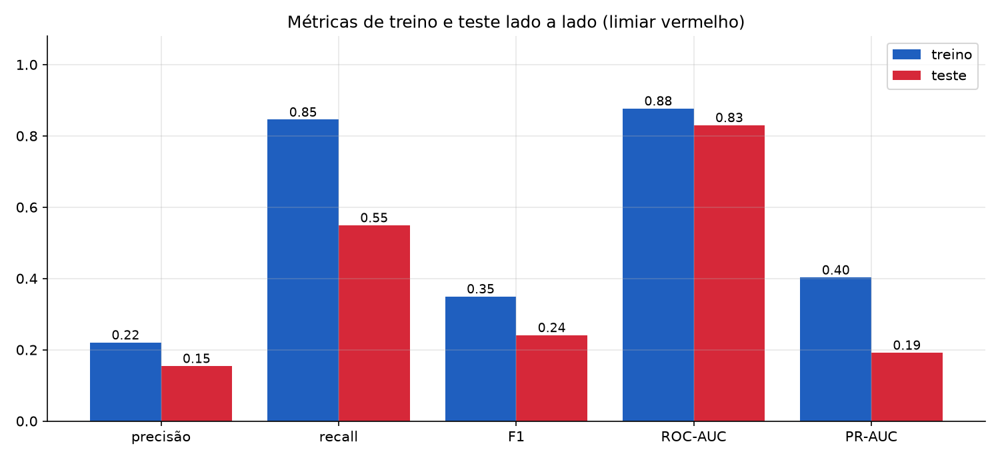

# AlertaEnchente · Previsão de chuva intensa (IA & Machine Learning)

Entrega de **Inteligência Artificial & Machine Learning** · FIAP · Engenharia de Software (3º ano) · Global Solution 2026.2 · CitizenTech

O **AlertaEnchente** avisa moradores de áreas alagáveis do Jardim Helena (Zona Leste de São Paulo) com um farol verde, amarelo e vermelho. Este módulo de Machine Learning dá **antecedência** ao farol: com dados reais do INMET, estima se as próximas 24 horas terão **20 mm de chuva ou mais**.

## Equipe

| Integrante | RM |
|---|---|
| Arthur Silva | RM553320 |
| Eduardo Escudero | RM556527 |
| Leonardo Prado | RM556824 |
| Davi Vieira | RM556798 |
| Luca Monteiro | RM556906 |

## Entregas

| Item | Onde |
|---|---|
| Notebook executado | [`ml/previsao_chuva_intensa.ipynb`](ml/previsao_chuva_intensa.ipynb) |
| Relatório (do problema à conclusão) | [`ml/RELATORIO_ML.md`](ml/RELATORIO_ML.md) |
| Fonte, período e colunas dos dados | [`ml/dados/README.md`](ml/dados/README.md) |
| Dependências | [`ml/requirements.txt`](ml/requirements.txt) |
| Gráficos e métricas | [`ml/resultados/`](ml/resultados) |
| Registro de uso de IA | [`prompts.md`](prompts.md) |
| Vídeo (3min34s) | https://youtu.be/SU0VIFzwkMw |

## Resumo em 30 segundos

| Etapa | O que fizemos |
|---|---|
| Problema e dados | Pergunta "vai chover 20 mm ou mais nas próximas 24 h?". Dados horários **reais** do INMET de 2022 a 2025: estações A701 (Mirante de Santana) e A771 (Interlagos). 32.261 exemplos, 7,1% positivos |
| Modelo | **Random Forest** com peso para a classe rara, justificado contra LSTM, MLP, XGBoost e KMeans |
| Preparação | Limpeza de `-9999` e valores impossíveis, 25 variáveis só com informação do passado, divisão **pela ordem do tempo** (80/20) com 24 h de folga |
| Treino | **24 combinações** de `max_depth`, `min_samples_leaf` e `max_features`, com validação cruzada temporal **só no treino** |
| Resultados | Teste: ROC-AUC **0,830**, F1 **0,241**, recall **0,549**. Supera as regras simples (F1 0,148 e 0,126). Sobreajuste medido: a validação cruzada previu a PR-AUC do teste (0,193 contra 0,192) |
| Para o cidadão | Nos 11 dias de chuva forte do teste, o farol vermelho avisou na véspera ou no dia em **todos os 11**, mas com cerca de 7 alarmes falsos por mês. Por isso o modelo é a camada de "prepare-se" do AlertaEnchente; a ordem de sair de casa vem do sensor do córrego ou da Defesa Civil |



## Como rodar

Pré-requisito: **Python 3.11 ou superior**.

```bash
git clone https://github.com/duduescudero/alerta-enchente-ml.git
cd alerta-enchente-ml
python -m venv .venv
# Windows: .venv\Scripts\activate    |    Linux/Mac: source .venv/bin/activate
pip install -r ml/requirements.txt
jupyter notebook ml/previsao_chuva_intensa.ipynb
```

Execute as células na ordem ("Run All"). O notebook roda direto com o CSV que já está em `ml/dados/`, que foi extraído dos arquivos oficiais do INMET. Para refazer tudo a partir dos ZIPs originais, coloque `2022.zip` a `2025.zip` em `ml/dados/brutos/`, ou deixe o próprio notebook baixá-los. Os links estão em [`ml/dados/README.md`](ml/dados/README.md).

A execução completa leva de 5 a 10 minutos: são 24 combinações × 4 dobras de Random Forest. O resultado é reproduzível (`random_state=42`).

## Estrutura

```
ml/
  previsao_chuva_intensa.ipynb   notebook executado, com todas as saídas
  RELATORIO_ML.md                relatório
  requirements.txt               dependências
  dados/
    README.md                    fonte, estações, colunas e como reproduzir
    inmet_sp_a701_a771_2022_2025.csv   dados horários extraídos do INMET
    brutos/                      ZIPs oficiais (fora do Git, cerca de 390 MB)
  resultados/                    gráficos, busca_hiperparametros.csv e metricas.json
prompts.md                       registro de uso de IA
```

## ODS

ODS 11 (cidades sustentáveis), ODS 13 (ação contra a mudança do clima) e ODS 9 (inovação e infraestrutura).
