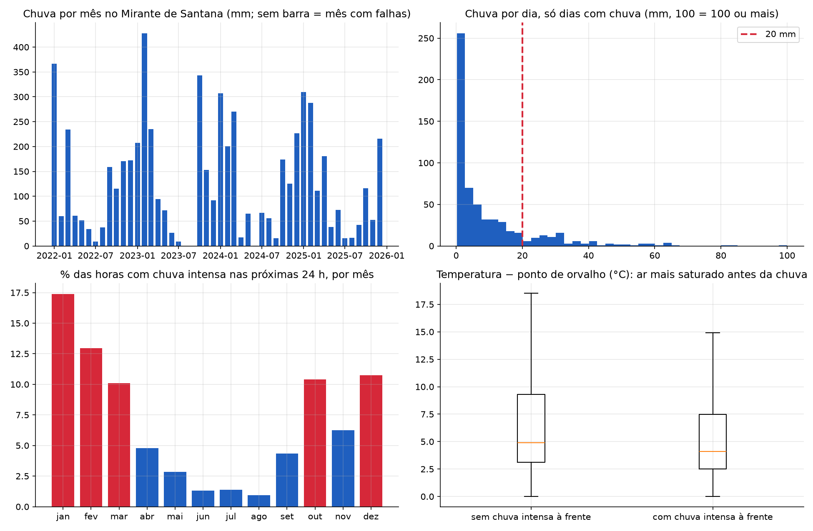
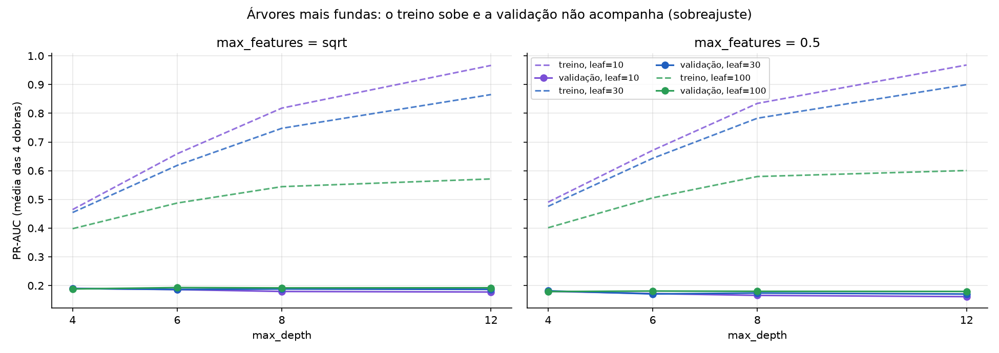
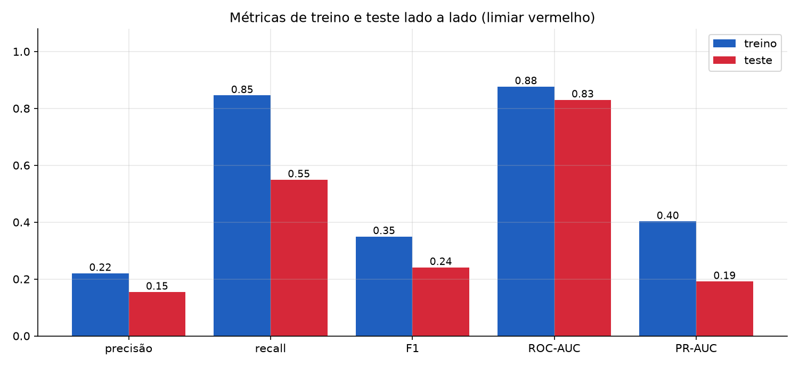
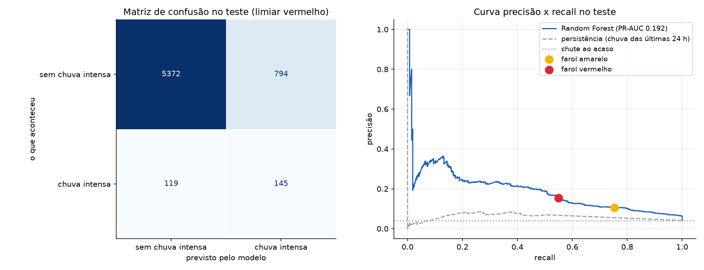
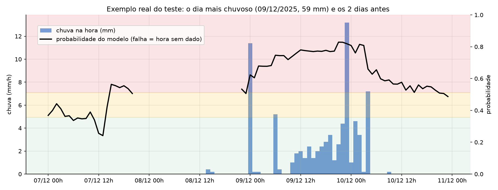

# Relatório de Machine Learning · AlertaEnchente

**Global Solution 2026.2 · CitizenTech · FIAP · Engenharia de Software (3º ano) · Inteligência Artificial & Machine Learning**

Equipe AlertaEnchente: Arthur Silva (RM553320) · Eduardo Escudero (RM556527) · Leonardo Prado (RM556824) · Davi Vieira (RM556798) · Luca Monteiro (RM556906)

Notebook executado: [`previsao_chuva_intensa.ipynb`](previsao_chuva_intensa.ipynb) · Números: [`resultados/metricas.json`](resultados/metricas.json) · Vídeo: https://youtu.be/SU0VIFzwkMw

## 1. Problema e pergunta de ML

O **AlertaEnchente** é a nossa CitizenTech para os moradores de áreas alagáveis do Jardim Helena, na Zona Leste de São Paulo. Hoje o aviso de enchente chega tarde: quando a rua já está alagando. O app mostra um farol **verde / amarelo / vermelho**, e este módulo de ML dá a ele **antecedência**.

> **Pergunta:** com as medições meteorológicas disponíveis agora, as próximas 24 horas vão acumular **20 mm de chuva ou mais** no Mirante de Santana?

É uma classificação binária, com uma previsão por hora. O limite de 20 mm em 24 h foi definido pela equipe para separar a chuva comum da chuva que causa transtorno; não é um limite oficial.

## 2. Dados reais

| Item | Detalhe |
|---|---|
| Fonte | INMET, Banco de Dados Históricos: https://portal.inmet.gov.br/dadoshistoricos |
| Estações | **A701 São Paulo - Mirante** (alvo e variáveis principais) e **A771 São Paulo - Interlagos** (apoio) |
| Período | 01/01/2022 a 31/12/2025, registros horários: 35.064 horas |
| Base final | 32.261 exemplos, 2.278 positivos (**7,1%**) |

Detalhes de colunas, unidades e reprodução estão em [`dados/README.md`](dados/README.md). Nenhum dado é simulado.

**Preparação:**
- Valores `-9999` (falha do sensor) e valores impossíveis viram ausentes.
- Linhas com o alvo incompleto saem da base: se faltar qualquer hora da janela futura, a linha não é usada.
- Os ausentes das variáveis são preenchidos pela mediana **do treino**, dentro do pipeline.
- O pluviômetro da A701 falhou em parte de agosto e setembro de 2023. Essas horas não viraram dado inventado.

**Variáveis (25):** todas usam **só informação até a hora atual**.
- O ar agora: temperatura, ponto de orvalho, umidade, pressão, vento, rajada e direção do vento.
- Saturação: temperatura menos ponto de orvalho.
- Tendências: variação da pressão em 3 h e 12 h, da umidade e da temperatura em 3 h.
- Chuva acumulada de 1, 3, 6, 24 e 72 h e horas desde a última chuva.
- Chuva, umidade e pressão em Interlagos.
- Hora e mês.

A análise exploratória mostra a chuva concentrada de outubro a março (em janeiro, 17% das horas têm chuva forte à frente, contra 1% em agosto) e o ar mais perto da saturação antes da chuva intensa.

## 3. Modelo e divisão treino/teste

**Random Forest**, com `class_weight='balanced_subsample'`.

**Por que essa escolha:**
- Funciona bem com dados tabulares e relações não lineares (umidade alta **e** pressão caindo).
- Não exige padronizar as variáveis.
- Compensa a raridade dos positivos.
- Permite explicar ao cidadão o que pesa na decisão.

**Por que não as outras opções:**
- **LSTM:** precisaria de muito mais dados do que 4 anos de uma estação, com 7% de positivos.
- **MLP:** sofre com ausentes e é difícil de explicar.
- **XGBoost:** tem mais hiperparâmetros sensíveis, com risco maior de sobreajuste com poucos positivos.
- **KMeans:** não responde a pergunta, porque não é supervisionado.

**Divisão pela ordem do tempo, sem embaralhar:**

| Conjunto | Período | Exemplos | Positivos |
|---|---|---|---|
| Treino (80%) | 01/01/2022 a 07/03/2025 | 25.808 | 2.014 (7,8%) |
| Teste (20%) | 08/03/2025 a 30/12/2025 | 6.430 | 264 (4,1%) |

Há uma folga de 24 h entre treino e teste, para a janela do alvo não vazar. O teste foi usado **uma única vez**, no fim.

## 4. Treino com diferentes parâmetros

São **24 combinações de 3 hiperparâmetros**:
- `max_depth`: 4, 6, 8 e 12;
- `min_samples_leaf`: 10, 30 e 100;
- `max_features`: `'sqrt'` e 0,5.

O número de árvores ficou fixo em 300. A validação cruzada é **temporal** (`TimeSeriesSplit`, 4 dobras, folga de 24 h) e roda **só no treino**. A métrica de escolha foi a **PR-AUC**, adequada para classes raras.

- **Melhor combinação:** `max_depth=6`, `min_samples_leaf=100`, `max_features='sqrt'`, com PR-AUC de validação de **0,193**.
- **O gráfico mostra o sobreajuste:** com árvores fundas e folhas pequenas, o treino chega a 0,968, mas a validação cai para 0,161.

**Limiares do farol:** foram escolhidos com previsões fora da amostra **dentro do treino**.
- **Vermelho = 0,512:** o ponto de melhor F1.
- **Amarelo = 0,356:** pega 80% das horas que antecedem chuva intensa.

## 5. Resultados em treino e teste

| Métrica (limiar vermelho) | Treino | Teste |
|---|---:|---:|
| Precisão | 0,220 | 0,154 |
| Recall | 0,846 | 0,549 |
| F1 | 0,350 | 0,241 |
| ROC-AUC | 0,877 | 0,830 |
| PR-AUC | 0,403 | 0,192 |

**Sobreajuste:**
- A queda do treino para o teste confirma que as árvores se ajustam ao que viram.
- Mas a PR-AUC da validação cruzada (0,193) bateu com a do teste (0,192). A estimativa feita só com o treino foi honesta.
- O teste também é mais difícil: tem metade da taxa de positivos do treino, porque cobre o inverno seco de 2025.
- A ROC-AUC, que não depende dessa taxa, caiu pouco (0,877 → 0,830).

**Comparação no teste:**

| Abordagem | Precisão | Recall | F1 |
|---|---:|---:|---:|
| Sempre "não" | 0,000 | 0,000 | 0,000 |
| Já choveu 4 mm ou mais nas últimas 24 h | 0,082 | 0,273 | 0,126 |
| Alertar de dezembro a março | 0,093 | 0,367 | 0,148 |
| **Random Forest** | **0,154** | **0,549** | **0,241** |

A PR-AUC do modelo (0,192) é 4,7 vezes a de um chute ao acaso (0,041). As variáveis que mais pesam, medidas por permutação no teste, são:
- o ponto de orvalho;
- a pressão;
- a chuva das últimas horas.

## 6. Conclusão para o cidadão

Olhando o teste dia a dia (299 dias de 2025):

| Farol | Dias de chuva forte avisados (na véspera ou no dia) | Dias com alarme falso |
|---|---|---|
| Vermelho | **11 de 11** | 72 (cerca de 7 por mês) |
| Amarelo ou vermelho | 11 de 11 | 113 |

No dia mais chuvoso do teste (09/12/2025, 59 mm), o farol já estava vermelho desde a tarde do dia 7, mais de 30 horas antes.

**O que isso significa para o morador:**
- **O modelo não deixou passar nenhum dia de chuva forte.**
- **Mas alarma demais para, sozinho, mandar alguém sair de casa.**

Por isso, no AlertaEnchente, ele é a camada de **antecedência**. O vermelho do modelo diz "prepare-se": tire documentos e objetos do chão, deixe o celular carregado e combine para onde ir. A ordem de sair de casa só vem com o sensor de nível do córrego (Physical Computing) ou com a Defesa Civil.

**Limitações:**
- O alvo é medido a cerca de 20 km do Jardim Helena; não existe estação do INMET na Zona Leste.
- São só 4 anos de dados.
- O modelo não usa radar.
- Chuva forte não é o mesmo que alagamento.

**Próximos passos:**
- Treinar com mais anos (a A701 mede desde 2006).
- Somar o radar e as estações do CGE.
- Prever o alagamento com os dados do sensor do córrego.

**ODS:**
- **ODS 11:** cidades mais seguras e resilientes.
- **ODS 13:** adaptação ao clima.
- **ODS 9:** dados públicos virando serviço.
